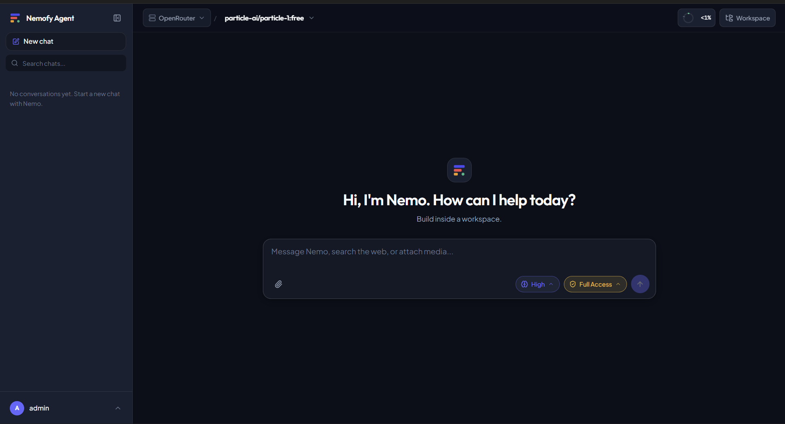
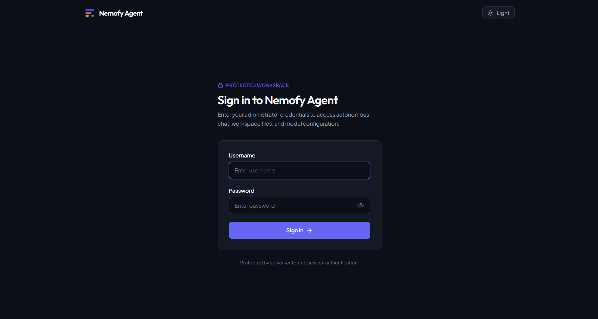
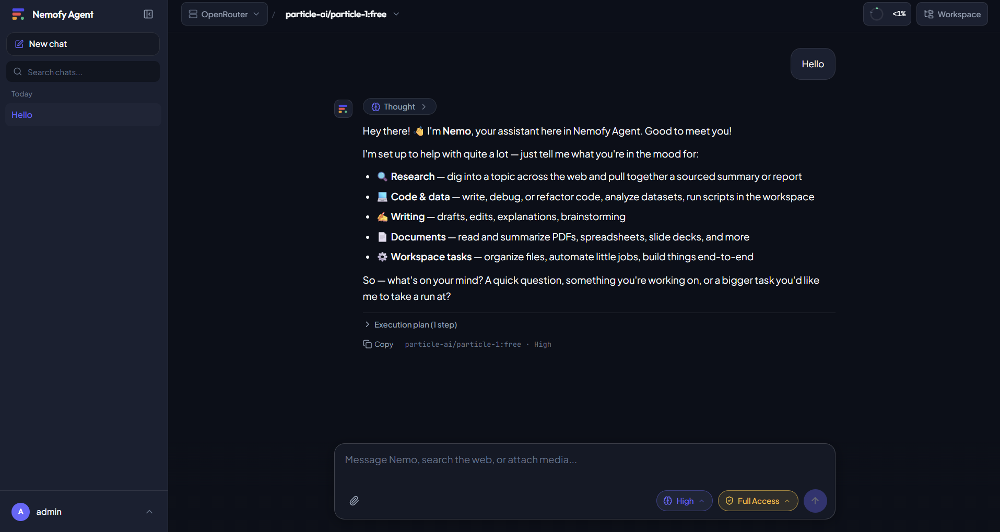
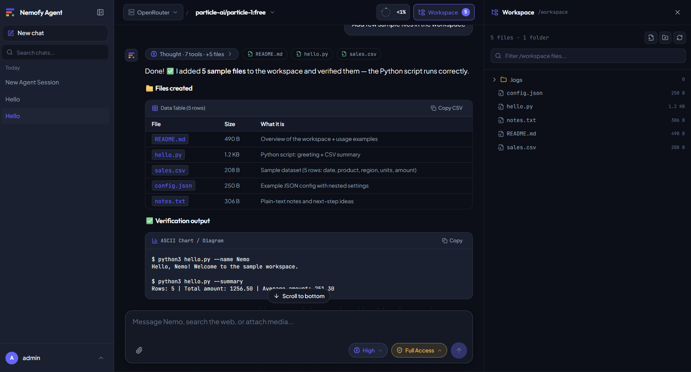
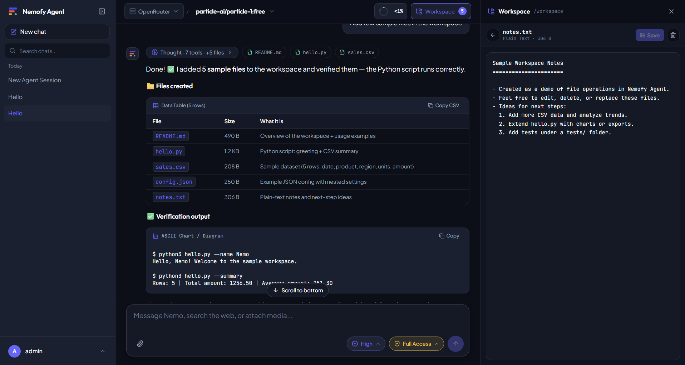
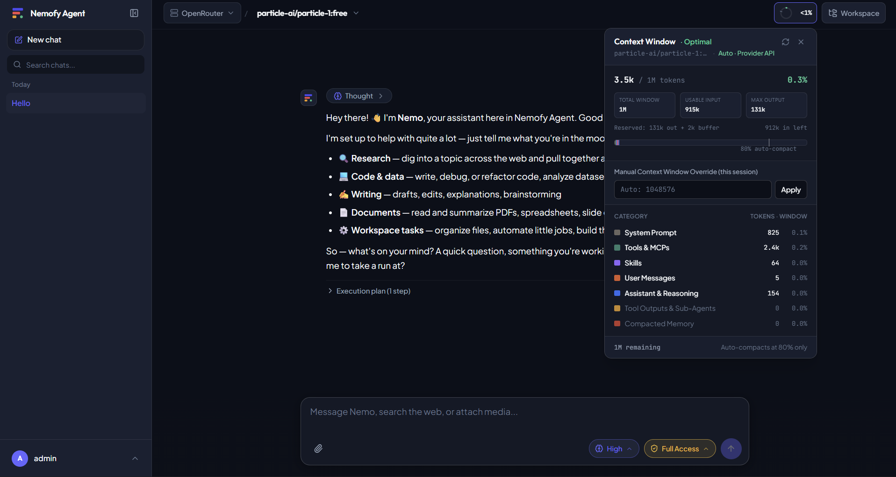
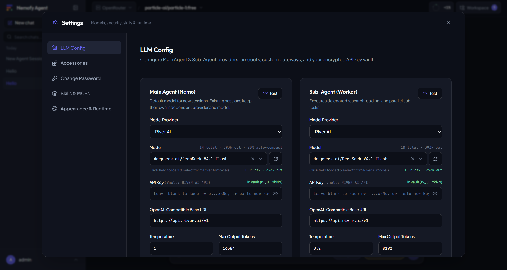
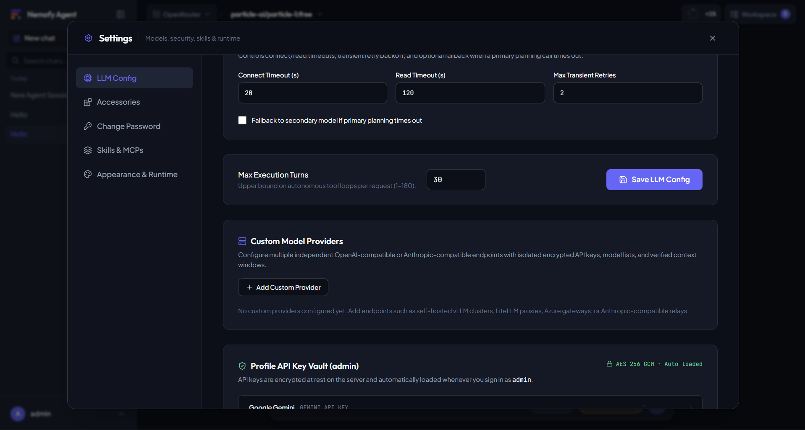
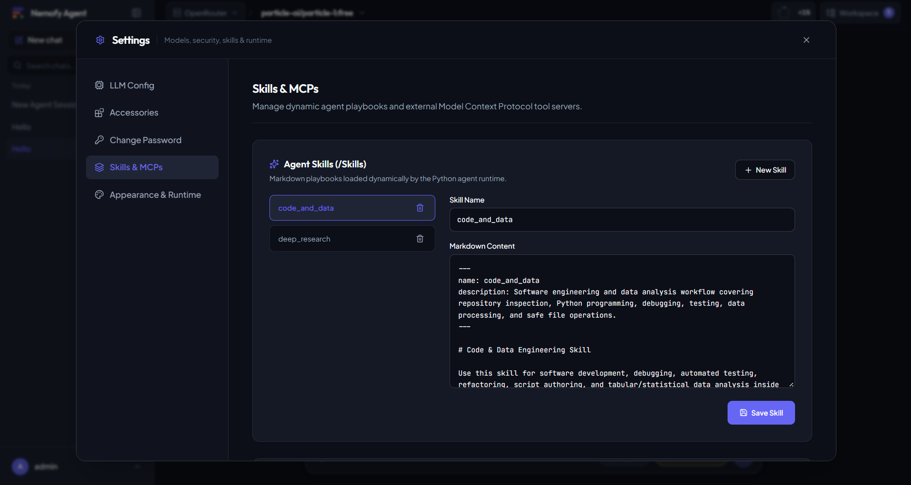
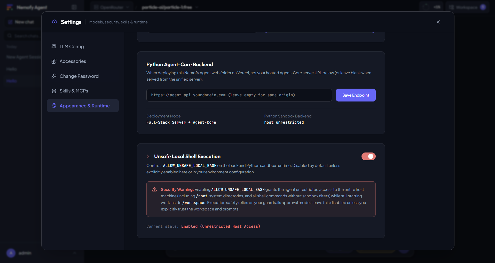

# Nemofy Agent

> **Your private, self-hosted AI assistant that can think step by step, search the web, write and run code, organize files in a live workspace, and work with almost any AI model you choose.**



---

## What Is Nemofy Agent?

Most AI chat apps only let you talk to a model in a text box. **Nemofy Agent** gives your AI assistant (**Nemo**) its own workspace and toolkit so it can actually *get work done* while keeping you in full control:

- **Research the web** — Search live websites, pull clean summaries, and read PDFs, Word docs, spreadsheets, and slide decks.
- **Write, run, and verify code** — Create scripts, analyze CSV datasets, test its own work, and show you the exact output.
- **Work with real files** — Browse, edit, save, and organize files in a built-in `/workspace` drawer right beside your chat.
- **Use any AI provider you like** — Plug in OpenRouter, River AI, OpenAI, Anthropic, Google Gemini, DeepSeek, Groq, NVIDIA, local Ollama models, or your own custom API endpoints.
- **Stay private and safe** — Runs on your own machine or server behind a password-protected login, encrypts your API keys at rest, and asks for your approval before running sensitive actions.

---

## Quick Navigation

- [Visual Tour: See Nemofy in Action](#visual-tour-see-nemofy-in-action)
- [5-Minute Quickstart](#5-minute-quickstart)
- [How Safety & Privacy Work](#how-safety--privacy-work)
- [Key Capabilities at a Glance](#key-capabilities-at-a-glance)
- [For Developers & Power Users](#for-developers--power-users)
  - [Use `Agent-Core` in Your Own Python Projects](#use-agent-core-in-your-own-python-projects)
  - [Run from the Terminal (CLI)](#run-from-the-terminal-cli)
  - [System Architecture & Engine Details](#system-architecture--engine-details)
  - [Project Structure](#project-structure)
  - [Configuration & API Reference](#configuration--api-reference)
  - [Tests & Live Benchmarks](#tests--live-benchmarks)
- [Common Questions & Troubleshooting](#common-questions--troubleshooting)

---

## Visual Tour: See Nemofy in Action

### 1. Private, Password-Protected Access
When you open Nemofy Agent for the first time, you set up your own administrator username and password. Every chat, file, and API key stays protected behind your login, with a one-click **Light / Dark** theme toggle in the top corner.



---

### 2. Clean Chat with Live Thinking & Execution Plans
Chat with Nemo just like any modern assistant—while seeing *how* it works behind the scenes:
- Switch AI providers and models at the top bar **per conversation** without affecting your other chats.
- Expand the **Thought** pill to inspect Nemo's reasoning process or check the **Execution plan** at the bottom of a reply.
- Adjust **Thinking Depth** (`Off`, `Low`, `Medium`, `High`) and **Access Mode** (`Default` approvals vs. `Full Access`) right inside the message box.



---

### 3. Autonomous File Creation & Live Workspace Drawer
Ask Nemo to create files, crunch numbers, or test a script—it doesn't just paste code for you to copy. It builds files directly inside `/workspace`, runs verification commands, summarizes the results in clean tables (with one-click **Copy CSV**), and updates the **Workspace** panel in real time.



---

### 4. View & Edit Workspace Files Side by Side
Click any file in the right-hand **Workspace** drawer (or click a file chip inside Nemo's message) to open it instantly. You can inspect, edit, save, or delete files without switching tabs or opening a separate editor.



---

### 5. Live Context Window Gauge & Automatic Memory Compaction
Long AI conversations normally slow down or hit token limits unexpectedly. Click the circular gauge in the top-right corner at any time to see a live breakdown of how much context window is used by your system prompt, tools, skills, messages, and tool outputs.

When a conversation reaches **80% capacity**, Nemo automatically summarizes older messages in the background so your chat stays fast and coherent—and you can even override the context limit per session if needed.



---

### 6. Dual-Model Setup: Main Agent + Fast Worker Sub-Agent
Inside **Settings → LLM Config**, you can assign two separate models:
- **Main Agent (Nemo)** — Your primary brain for planning, reasoning, and talking with you.
- **Sub-Agent (Worker)** — A fast, cost-effective helper model that Nemo delegates parallel research or coding sub-tasks to.

Pick from 12+ built-in providers, search live model catalogs with verified context limits, and click **Test** to confirm your connection in seconds.



---

### 7. Encrypted API Key Vault, Custom Providers & Reliability Controls
Scroll down in **LLM Config** to fine-tune how Nemo handles real-world hiccups and custom endpoints:
- **Timeouts, Retries & Automatic Fallback** — Automatically retry transient network errors or fall back to your secondary model if your primary model times out.
- **Custom Model Providers** — Connect any self-hosted vLLM cluster, LiteLLM proxy, Azure gateway, or OpenAI/Anthropic-compatible relay.
- **Profile API Key Vault** — Your API keys are encrypted on the server using **AES-256-GCM** and loaded automatically when you sign in—so you never have to leave raw keys sitting in plain text config files.



---

### 8. Teach Nemo New Playbooks with Skills & MCPs
Want Nemo to follow your preferred workflow for coding, writing reports, or auditing data? Open **Settings → Skills & MCPs** to create or edit reusable Markdown playbooks (like `code_and_data` and `deep_research`) directly in the browser. Nemo loads only the skills it needs on demand, keeping chats lean. You can also connect external **MCP (Model Context Protocol)** tool servers from the same tab.



---

### 9. Flexible Deployment & Transparent Shell Safety Controls
Open **Settings → Appearance & Runtime** to check your active runtime mode, point a Vercel-hosted frontend to your own remote Python backend URL, or review shell execution safety.

By default, local shell execution stays locked down (`disabled`). If you're running on a trusted personal machine without Docker and want to allow unrestricted local shell commands, you can explicitly opt in with clear security warnings right in the UI.



---

## 5-Minute Quickstart

### What You Need
- **Node.js 22+** and **npm**
- **Python 3.11+**
- *(Optional)* **Docker** — If you want one-command containerized deployment or Docker-isolated code execution.

---

### Option 1: Run Locally on Your Computer (Recommended)

1. **Install Node.js packages:**
   ```bash
   npm install
   ```

2. **Install Python dependencies** *(optional — `npm run dev` can also set up `.venv` automatically on first run)*:
   ```bash
   python3 -m venv .venv
   .venv/bin/pip install --upgrade pip
   .venv/bin/pip install -e ".[dev]"
   ```

3. **Start Nemofy Agent:**
   ```bash
   npm run dev
   ```
   This starts everything in one command: the web interface (`http://localhost:3000`), the Python agent engine (`:8100`), and local web search (`:3002`, if installed).

4. **Open [http://localhost:3000](http://localhost:3000) in your browser:**
   - Create your admin username and password on the welcome gate.
   - Open **Settings → LLM Config**, paste an API key for any provider you use (OpenRouter, River AI, OpenAI, Anthropic, Gemini, DeepSeek, Groq, or local Ollama), and click **Test**. *(No need to manually edit `.env` files!)*
   - Say hello to Nemo and start building!

---

### Option 2: One-Command Docker Setup

Prefer not to install Python, Chromium, or Rust tools manually? Docker builds the entire stack—including **Firecrawl Local** web research and **Chromium** for JavaScript-heavy pages—into one container with persistent data volumes:

```bash
# Build and start on http://localhost:3000
npm run docker:up

# View logs or stop later
npm run docker:logs
npm run docker:down
```

*(Optional)* Build the isolated Docker code-execution sandbox image:
```bash
docker build -f Agent-Core/Dockerfile.sandbox -t nemofy-agent-sandbox:latest Agent-Core
```

---

### Option 3: Host the Web UI on Vercel

1. Import this repository into **Vercel** and set the **Root Directory** to `Nemofy Agent`.
2. Vercel automatically detects Vite (`Nemofy Agent/vercel.json` is pre-configured).
3. Point the UI to your hosted backend URL by setting `VITE_AGENT_API_URL` (or entering it directly in **Settings → Appearance & Runtime**).

---

## How Safety & Privacy Work

Nemofy Agent is designed so you can trust an autonomous AI on your own machine:

1. **You hold the keys:** API keys entered in Settings are encrypted with **AES-256-GCM** per user profile and are never written in plain text to `llm_config.json`.
2. **Human-in-the-Loop approvals:** In **Default** mode, read-only actions happen automatically while sensitive actions (modifying system state, running write/shell commands, or calling external tools) pause and ask you to **Approve**, **Edit**, or **Reject** first. Want hands-free speed on a trusted task? Switch that individual chat to **Full Access**.
3. **Confined workspace:** Files stay neatly inside `/workspace` with path-traversal and symlink-escape protection, and secrets are scrubbed from sandboxed subprocess environments.
4. **Crash-safe memory:** Every step is saved to a local SQLite checkpoint database. Even if you restart the server while Nemo is waiting for your approval, it picks up right where it left off without repeating completed actions.

---

## Key Capabilities at a Glance

| Capability | What It Does for You |
| :--- | :--- |
| **12+ Providers + Custom APIs** | River AI, OpenRouter, OpenAI, Anthropic, Google Gemini, NVIDIA NIM, DeepSeek, Groq, Together, Fireworks, Ollama, vLLM, plus unlimited custom OpenAI/Anthropic-compatible endpoints. |
| **Multimodal Attachments** | Upload images, videos, or audio files. If your main chat model doesn't support a media type natively, Nemofy automatically routes it to a dedicated **Accessory** model behind the scenes. |
| **Built-In Web Research & Docs** | Integrated with **Firecrawl Local** (`web_search`, `web_fetch`, `web_crawl`, `web_map`, `web_extract`) plus native parsing for PDF, DOCX, XLSX, and PPTX documents. |
| **Smart Context Management** | Real-time token gauge, strict **80% auto-compaction**, and automatic archiving of huge tool logs (`>4,000` chars) to `/workspace/.logs/` so chats stay sharp. |
| **Skills & MCP Ecosystem** | Add reusable Markdown instruction playbooks (`/Skills`) and connect external Model Context Protocol servers (`/MCPs/servers.json`). |
| **Standalone Python Engine** | The core LangGraph engine (`Agent-Core/`) has zero UI coupling—reuse it directly inside your own Python apps or FastAPI services. |

---

## For Developers & Power Users

### Use `Agent-Core` in Your Own Python Projects

You can import `agent_core` directly in any Python project without running Express, React, or `MCPs/`:

```python
import asyncio
from pathlib import Path
from langchain_core.tools import tool
from langgraph.checkpoint.memory import MemorySaver

from agent_core import (
    AgentConfig,
    AgentHooks,
    AgentPersona,
    ExecutionLimits,
    GuardrailPolicy,
    SandboxConfig,
    SandboxManager,
    create_agent_runtime,
)

@tool("lookup_order")
def lookup_order(order_id: str) -> str:
    """Look up an order's shipping status."""
    return f"Order {order_id}: out for delivery"

async def main() -> None:
    sandbox = SandboxManager(
        SandboxConfig(workspace_dir=Path("./workspace"), backend="local_isolated")
    )
    config = AgentConfig(
        persona=AgentPersona(
            name="Support Agent",
            organization="Acme Corp",
            role_description="a concise order support specialist",
            extra_instructions="Always confirm the order ID in your reply.",
        ),
        limits=ExecutionLimits(max_turns=12, max_wall_clock_seconds=45.0),
        guardrail_policy=GuardrailPolicy().extend(add_safe_tools=("lookup_order",)),
        hooks=AgentHooks(
            on_tool_end=lambda ev: print(f"[hook] {ev['tool']} -> {ev['status']}"),
            on_run_complete=lambda ev: print(f"[hook] run finished: {ev['status']}"),
        ),
        include_default_tools=False,
        enable_skills=False,
        enable_subagents=False,
        custom_checkpointer=MemorySaver(),  # Or omit for durable SQLite WAL
    )

    async with create_agent_runtime(
        sandbox=sandbox,
        extra_tools=[lookup_order],
        connect_mcp=False,
        config=config,
    ) as runtime:
        result = await runtime.run_task("Where is order ORD-1042?", thread_id="ticket-42")
        print(result["final_response"])

asyncio.run(main())
```

Or expose it as a standalone FastAPI service:

```python
from agent_core import AgentConfig, create_app

app = create_app(
    checkpoint_db_path=":memory:",  # Pure in-memory SQLite (zero disk files)
    connect_mcp=False,
    agent_config=AgentConfig(app_title="Custom Domain Agent API"),
)
```

For full library documentation, see [`Agent-Core/README.md`](Agent-Core/README.md).

---

### Run from the Terminal (CLI)

Prefer working straight from your terminal?

```bash
# Check configuration, sandbox, skills, and model connectivity
PYTHONPATH=Agent-Core:. .venv/bin/python Agent-Core/main.py --check

# Start an interactive terminal session with Human-in-the-Loop approvals
PYTHONPATH=Agent-Core:. .venv/bin/python Agent-Core/main.py --thread-id my-session
```

---

### System Architecture & Engine Details

Nemofy Agent is split into three clean layers:
1. **`Nemofy Agent/`** (React 19 + Vite 8 + Tailwind CSS 4) — The web workspace UI.
2. **`server.ts` & `server/`** (Node.js 22 + Express + TypeScript) — Auth, AES-256-GCM key vault, thread storage, model catalog, and process supervision on port `:3000`.
3. **`Agent-Core/`** (Python 3.11+ + LangGraph + FastAPI + SQLite WAL) — Cyclic reasoning/execution engine (`Plan → Act → Observe → Reflect → Response`), sandbox isolation, guardrails, context compaction, skills, sub-agents, and MCP client on port `:8100`.

<details>
<summary><strong>Click to expand: Full-Stack System Architecture Diagram</strong></summary>

```text
+======================================================================================+
|                           BROWSER CLIENT (Light / Dark UI)                           |
|  Nemofy Agent SPA (React 19 + Vite 8 + Tailwind v4)                                  |
|  [LoginGate] -> [Sidebar Threads] [ChatView + ActivityPanel + HITL] [WorkspaceDrawer]|
|                 [ContextUsageRing] [ModelSelectorCombobox] [SettingsModal]           |
+=========================================+============================================+
                                          | HTTPS / Same-Origin Cookie (HttpOnly)
                                          v
+======================================================================================+
|                    EXPRESS API GATEWAY  (server.ts  :3000)                           |
|                                                                                      |
|  +-----------------------+  +------------------------+  +-------------------------+  |
|  | AuthStore             |  | ProfileSecretVaultStore|  | WorkspaceAndConfigStore |  |
|  | scrypt + timingSafeEq |  | AES-256-GCM + scrypt   |  | Atomic JSON persistence |  |
|  | Session cookies       |  | data/vaults/<user>.json|  | /workspace, Skills, MCP |  |
|  +-----------------------+  +-----------+------------+  +-------------------------+  |
|                                         | Syncs decrypted keys in-memory only        |
|  +-----------------------+  +-----------v------------+  +-------------------------+  |
|  | ChatJobOrchestrator   |  | ProviderCatalog        |  | Process Managers        |  |
|  | Background polling    |  | Live /models + context |  | AgentCoreProcessManager |  |
|  | Thread race-locking   |  | windows + SSRF guard   |  | FirecrawlProcessManager |  |
|  +-----------+-----------+  +------------------------+  +-----------+-------------+  |
+==============|======================================================|================+
               | Bearer AGENT_API_TOKEN (127.0.0.1:8100)              | 127.0.0.1:3002
               v                                                      v
+===========================================================+  +-----------------------+
|          AGENT-CORE ENGINE (FastAPI + LangGraph :8100)    |  | FIRECRAWL LOCAL :3002 |
|                                                           |  | Native Rust binary    |
|  [JobManager + Heartbeat Watchdog]                        |  | - HTML -> Markdown    |
|         |                                                 |  | - JS via Chromium     |
|         v                                                 |  | - Native PDF/DOCX/    |
|  [LangGraph Supervisor: Plan -> Act -> Observe -> Reflect]|  |   XLSX/PPTX parser    |
|    |-- ContextManager (80% auto-compaction + budgets)     |  +-----------------------+
|    |-- Guardrails & HITL Interrupts (SAFE vs SENSITIVE)   |
|    |-- SandboxManager (Docker OR local_isolated)          |
|    |-- SkillRegistry (/Skills/*.md dynamic loading)       |
|    |-- Sub-Agent Runner (isolated worker LangGraph)       |
|    |-- Multimodal Accessories (Image / Video / Audio)     |
|    |-- MCPRegistryManager (/MCPs/servers.json)            |
|    +-- Checkpointer (SQLite WAL | :memory: | MemorySaver) |
+============================+==============================+
                             | OpenAI-Compatible / Native HTTPS
                             v
+======================================================================================+
|  12+ LLM PROVIDERS: River AI, OpenRouter, OpenAI, Anthropic, Google Gemini, NVIDIA,  |
|                     DeepSeek, Groq, Together, Fireworks, Ollama, vLLM + Custom APIs  |
+======================================================================================+
```

</details>

<details>
<summary><strong>Click to expand: Inside the Cyclic LangGraph Supervisor Engine</strong></summary>

`Agent-Core` executes **one tool call per checkpointed step**. If a model queues two tools and the second one pauses for human approval, the first tool is already saved in SQLite and is **never replayed** when you resume—even across a full restart.

```text
                                 User Task / Follow-Up
                                           |
                                           v
                       +---------------------------------------+
                       |             CONTEXT CHECK             |
                       |  Compute token usage vs context_window|
                       |  If usage >= 80% -> Auto-Compact old  |
                       |  turns (preserving tool-call pairs)   |
                       +-------------------+-------------------+
                                           |
                                           v
                  +--------------------------------------------------+
      +---------> |                    PLAN NODE                     |
      |           |  - Enforce max_turns & max_wall_clock_seconds    |
      |           |  - Build persona prompt + active skills catalog  |
      |           |  - Stream live <think>/reasoning tokens          |
      |           |  - Resilient retry + timeout fallback model      |
      |           +------------------------+-------------------------+
      |                                    |
      |                     +--------------+--------------+
      |                     |                             |
      |             Has tool_calls?               No tool_calls
      |                     |                             |
      |                     v                             v
      |           +-------------------+       +-----------------------+
      |           |     ACT NODE      |       |     RESPONSE NODE     |
      |           | (1 tool per step) |       | Extract final answer, |
      |           +---------+---------+       | thinking, file diffs, |
      |                     |                 | & context snapshot    |
      |                     v                 +-----------+-----------+
      |           +-------------------+                   |
      |           |  GUARDRAIL GATE   |                   v
      |           |  SAFE | SENSITIVE |              [COMPLETED]
      |           +----+---------+----+
      |                |         |
      |             SAFE     SENSITIVE (in default mode)
      |                |         |
      |                |         v
      |                |   [LangGraph interrupt()] ---> PAUSE (awaiting_approval)
      |                |         |                      Survives full restart!
      |                |   Human Decision:
      |                |   approve | edit (validated) | reject
      |                |         |
      |                +----+----+
      |                     v
      |           +-------------------+
      |           |  EXECUTE TOOL     |
      |           |  (Sandbox / Web / |
      |           |   Skills / MCP /  |
      |           |   Sub-Agent)      |
      |           +---------+---------+
      |                     |
      |                     v
      |           +-------------------+
      |           |   OBSERVE NODE    |
      |           |  >4,000 chars?    |
      |           |  Archive raw log  |
      |           |  /workspace/.logs |
      |           +---------+---------+
      |                     |
      |                     v
      |           +-------------------+
      |           |   REFLECT NODE    |
      |           |  Track retries,   |
      |           |  workspace diffs, |
      |           |  update plan step |
      +-----------+-------------------+
```

</details>

---

### Project Structure

```text
nemofy-agent/
├── Agent-Core/          # Standalone Python LangGraph engine, FastAPI service, CLI, tests & benchmarks
├── Nemofy Agent/        # React 19 + Vite 8 + Tailwind CSS 4 web app (Vercel-ready)
├── server.ts            # Unified Express API gateway (:3000)
├── server/              # Auth, AES-256-GCM key vault, provider catalog, job & process managers
├── Skills/              # Dynamic Markdown playbooks (code_and_data.md, deep_research.md)
├── MCPs/                # External Model Context Protocol client & servers.json
├── scripts/             # Installers for Firecrawl Local, Chromium & runtime dependencies
├── Dockerfile           # All-in-one production container (Rust + Node + Python + Chromium)
├── docker-compose.yml   # Single-command production deployment with persistent volumes
└── .env.example         # Documented environment variable reference
```

---

### Configuration & API Reference

Most settings can be managed directly in the web UI without touching `.env`. For advanced setups and integrations, expand the tables below.

<details>
<summary><strong>Click to expand: Environment Variables (.env.example)</strong></summary>

| Category | Key Variables | Default / Behavior |
| :--- | :--- | :--- |
| **Ports & Auth** | `PORT`, `AGENT_API_PORT`, `AGENT_API_TOKEN`, `NEMOFY_ADMIN_PASSWORD`, `VAULT_MASTER_KEY` | Web `:3000`, Agent-Core `:8100`; tokens/vault keys auto-generated securely if omitted |
| **Primary / Worker Models** | `PRIMARY_PROVIDER`, `PRIMARY_MODEL`, `PRIMARY_BASE_URL`, `PRIMARY_TEMPERATURE`, `PRIMARY_MAX_TOKENS`, `PRIMARY_REASONING_EFFORT` (and `WORKER_*`) | Defaults configurable via UI (`data/llm_config.json`) |
| **Provider API Keys** | `OPENAI_API_KEY`, `ANTHROPIC_API_KEY`, `OPENROUTER_API_KEY`, `RIVER_AI_API`, `NVIDIA_API_KEY`, `DEEPSEEK_API_KEY`, `GROQ_API_KEY`, `TOGETHER_API_KEY`, `FIREWORKS_API_KEY` | Recommended: enter via UI so keys stay encrypted in `data/vaults/<user>.vault.json` |
| **Resilience & Limits** | `MAX_TURNS`, `MODEL_CONNECT_TIMEOUT_SECONDS`, `MODEL_READ_TIMEOUT_SECONDS`, `MODEL_MAX_RETRIES` | `30` turns (`1..180`), `15s` connect, `180s` read, `2` retries |
| **Sandbox** | `SANDBOX_BACKEND` (`auto` \| `docker` \| `local_isolated`), `ALLOW_UNSAFE_LOCAL_BASH`, `SANDBOX_TIMEOUT_SECONDS`, `WORKSPACE_DIR` | Fail-closed (`ALLOW_UNSAFE_LOCAL_BASH=false`), `300s` timeout |
| **Firecrawl Local** | `FIRECRAWL_API_URL`, `FIRECRAWL_PORT`, `FIRECRAWL_LOCAL_AUTOSTART`, `FIRECRAWL_CHROME_PATH`, `FIRECRAWL_API_KEY` | `http://127.0.0.1:3002`, auto-starts if installed |
| **Storage & Paths** | `CHECKPOINT_DB_PATH`, `LLM_CONFIG_PATH`, `SKILLS_DIR`, `MCP_CONFIG_PATH` | `data/checkpoints.db`, `data/llm_config.json`, `Skills/`, `MCPs/servers.json` |

</details>

<details>
<summary><strong>Click to expand: HTTP API Endpoints (Express Gateway :3000 & Agent-Core :8100)</strong></summary>

#### Express Gateway (`http://localhost:3000`)

| Endpoint | Auth | Purpose |
| :--- | :---: | :--- |
| `GET /api/health` | Public | Gateway & Agent-Core readiness probe |
| `POST /api/auth/setup` / `login` / `logout` / `change-password` | Public / Cookie | Administrator authentication & session rotation |
| `GET/POST/DELETE /api/threads` | Cookie | Multi-thread chat history & per-session model config |
| `POST /api/chat/send` / `resume` / `cancel` | Cookie | Launch, approve/resume, or cancel background agent jobs |
| `GET /api/chat/jobs/:jobId` | Cookie | Live polling for thinking, tools, file diffs & context usage |
| `GET/PUT/POST/DELETE /api/workspace/*` | Cookie | Confined `/workspace` file & directory CRUD |
| `GET/PUT /api/settings/llm` & `POST /api/settings/probe` | Cookie | Dual-model, accessory, custom provider & vault management |
| `GET/PUT/DELETE /api/skills` & `GET/PUT /api/mcps` | Cookie | Manage dynamic Markdown skills and MCP servers |

#### Agent-Core FastAPI Service (`http://127.0.0.1:8100`)

| Endpoint | Auth | Purpose |
| :--- | :---: | :--- |
| `GET /health` | Public | Runtime, models, checkpoint, sandbox, Firecrawl, skills & MCP health |
| `POST /agent/run` & `POST /agent/resume` | Bearer | Synchronous LangGraph execution & HITL approval resume |
| `POST /agent/jobs/run` & `POST /agent/jobs/resume` | Bearer | Non-blocking async jobs (HTTP `202 Accepted`) |
| `GET /agent/jobs/{job_id}?wait_ms=...` | Bearer | Long-poll progress heartbeats, thinking stream & result |
| `POST /agent/jobs/{job_id}/cancel` | Bearer | Immediate cooperative cancellation of in-flight jobs |
| `POST /config/secrets` / `DELETE /config/secrets` | Bearer | In-memory sync of decrypted vault secrets from gateway |

</details>

---

### Tests & Live Benchmarks

Nemofy Agent is continuously verified across **100 Python tests**, **92 TypeScript unit tests**, static type checks, and a **6-suite live benchmark harness** covering latency, sandbox confinement, HITL safety, 80% auto-compaction, concurrent SQLite WAL threads, and live cloud LLM execution.

<details>
<summary><strong>Click to expand: Benchmark Scorecard & Verification Commands</strong></summary>

| # | Benchmark Suite | Measured Result | Verdict |
| :-: | :--- | :--- | :-: |
| 1 | **Supervisor Graph Latency & Persistence** | Direct p95 `41.9 ms` (`< 350 ms`); Multi-step p95 `106.2 ms` (`< 600 ms`); `:memory:` zero disk leak | **PASS** |
| 2 | **Sandbox Safety & Perf (`local_isolated`)** | Exec p95 `113.3 ms`; 1s timeout kill `1054 ms`; 100% traversal, symlink & env scrub blocks | **PASS** |
| 3 | **Guardrails, HITL & Wall-Clock Safety Cap** | Approve side-effects `1`, Reject `0`; Runaway loop halted in `305.7 ms` (`2` turns) | **PASS** |
| 4 | **Context Accounting & 80% Auto-Compaction** | Turns 1–2 uncompacted (`59.9%`, `63.0%`); Turn 3 (`>= 80%`) auto-compacted cleanly | **PASS** |
| 5 | **Concurrent SQLite WAL Isolation** | `12/12` parallel multi-step threads in `961.4 ms` wall; `0` cross-thread bleed or lock errors | **PASS** |
| 6 | **FastAPI Auth, Async Jobs & Cancellation** | `401` enforced; `8/8` jobs p95 `461.6 ms`; In-flight job cancel `4.8 ms` | **PASS** |

Run the verification suites yourself anytime:

```bash
# 1. Python syntax check + Ruff lint + Pytest suite (100 tests)
PYTHONPATH=Agent-Core:. .venv/bin/python Agent-Core/tests/self_test.py

# 2. TypeScript server + frontend unit tests (92 tests)
npx --yes tsx --test server/*.test.ts "Nemofy Agent/src/lib/"*.test.ts

# 3. TypeScript strict typecheck (root + standalone frontend)
npm run lint
npx tsc -p "Nemofy Agent/tsconfig.json" --noEmit

# 4. 6-suite Agent-Core benchmark harness
PYTHONPATH=Agent-Core:. .venv/bin/python Agent-Core/benchmarks/run_benchmarks.py

# 5. Production build
npm run build
```

</details>

---

## Common Questions & Troubleshooting

- **Why did Nemo say shell execution (`bash_exec`) is disabled?**
  For your safety, Nemofy blocks direct host shell commands when Docker isn't running. You can either build the Docker sandbox (`Agent-Core/Dockerfile.sandbox`) or—if you're on a trusted personal computer—turn on **Unsafe Local Shell Execution** under **Settings → Appearance & Runtime**.
- **Web search says `127.0.0.1:3002` (Firecrawl Local) isn't running. How do I enable it?**
  You have three easy choices: run via Docker (`npm run docker:up`, which includes Firecrawl + Chromium automatically), install it locally with `npm run firecrawl:install` (requires Rust/Cargo), or paste a Firecrawl Cloud API key in Settings.
- **I forgot my admin password—how do I reset it?**
  Stop the server, delete `data/auth.json` (and `data/vaults/` if you also want a fresh API key vault), and run `npm run dev` again to recreate your admin account.

---

## License

Released under the terms in [`LICENSE.md`](LICENSE.md).
